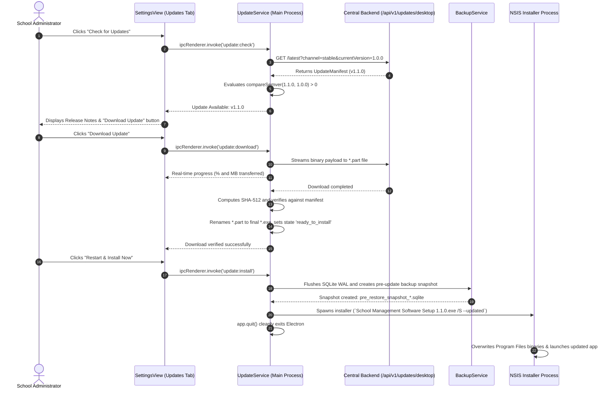

# School Management Software — Application Update Guide

**Document Version:** 1.0.0  
**Update Engine:** Embedded Electron UpdateService + Central School OS Backend Feed  
**Supported Update Channels:** `stable` (default) and `beta`

---

## 1. Overview & Update Safety Invariants

The application incorporates a local-first, cryptographically verified automatic update system designed specifically for mission-critical school environments.

### Core Update Safety Guarantees
1. **Zero Mid-Operation Disruptions:** Updates are never installed silently while school staff are recording payments, marks, or attendance.
2. **Pre-Update Safety Backup:** Before executing any update installer, the application flushes the active SQLite WAL checkpoint (`wal_checkpoint(TRUNCATE)`) and takes an automated encrypted backup (`triggerType: 'pre_migration'`).
3. **Cryptographic SHA-512 Verification:** Every downloaded installer payload is verified against the authoritative SHA-512 checksum published in the release manifest. If a single byte differs or the file is corrupted, it is deleted immediately.
4. **Data Isolation:** Update installers overwrite only application binaries in `Program Files`. The active database, audit log, licensing cache, and pending sync outbox in `%APPDATA%` remain untouched.
5. **Rollback Resilience:** If an update package fails to launch or a database schema migration encounters an error, the previous version database snapshot can be restored instantly from the backup repository.

---

## 2. Release Channels

The update system provides two distinct channels configurable in **Settings > Application Updates**:

| Channel | Intended Audience | Description |
| :--- | :--- | :--- |
| **`stable`** *(Default / Recommended)* | School Administrators, Accounts Staff | Fully validated production releases. Recommended for institutional operation. Only receives stable release packages. |
| **`beta`** | Pilot Schools, Technical Administrators | Early-access preview releases containing new upcoming modules, UI refinements, and feature previews. |

---

## 3. Update Manifest Schema

The update client contacts the update endpoint (defaults to `http://<backend-host>/api/v1/updates/desktop/latest?channel=<channel>&currentVersion=<version>&os=win32&arch=x64`).

Authoritative JSON Manifest format:
```json
{
  "version": "1.1.0",
  "releaseDate": "2026-11-14T00:00:00.000Z",
  "minSupportedVersion": "1.0.0",
  "mandatory": false,
  "channel": "stable",
  "windows": {
    "url": "http://localhost:5000/api/v1/updates/desktop/download/1.1.0",
    "sha512": "7cf07147fd111e4876415fe21529f4f448734dd8477dba54b5af0e3be12ca8ea1804e1f4b160538d4f7ff4a7c9f55ed79d4eb27f47ae5a6836968b8d43a675b6",
    "sizeBytes": 117738835,
    "installerType": "nsis",
    "minWindowsBuild": 19041
  },
  "releaseNotes": "- Performance optimizations for student rosters (Migration 009).\n- Multi-destination backup rotation.\n- Offline licensing resilience.",
  "databaseMigrationRequired": true,
  "targetSchemaVersion": 9
}
```

### Minimum Supported Version Enforcement
If the workstation's currently installed version is lower than `minSupportedVersion`, the update client marks the update as `mandatory: true`. The application prompts the administrator to update before proceeding with cloud synchronization to ensure database schema compatibility.

---

## 4. End-to-End Update Workflow



---

## 5. Troubleshooting & Recovery Procedures

### 5.1. Corrupted Update Download (`CORRUPT_UPDATE_PAYLOAD`)
- **Cause:** Network interruption or proxy corruption caused downloaded bytes to mismatch the SHA-512 checksum.
- **System Behavior:** The client deletes the `.part` file immediately and flags an error state. The active database and installation remain unaffected.
- **Action:** Click **Check for Updates** and retry the download.

### 5.2. Post-Update Launch Failure (Emergency Rollback)
If a newly installed update fails to start due to an OS-level incompatibility or power loss during replacement:
1. Reinstall the previous known stable version (e.g. `Setup 1.0.0.exe`).
2. The installer will overwrite the program binaries.
3. Because user data in `%APPDATA%` was preserved, the restored application will reopen `school_local.db` cleanly and replay the WAL journal.
4. If a schema migration had partially executed before the crash, locate the automated safety snapshot in `%APPDATA%\School Management Software\backups\pre_migration\` and restore it via **Settings > Automated Backup & Restore > Restore from Backup**.
