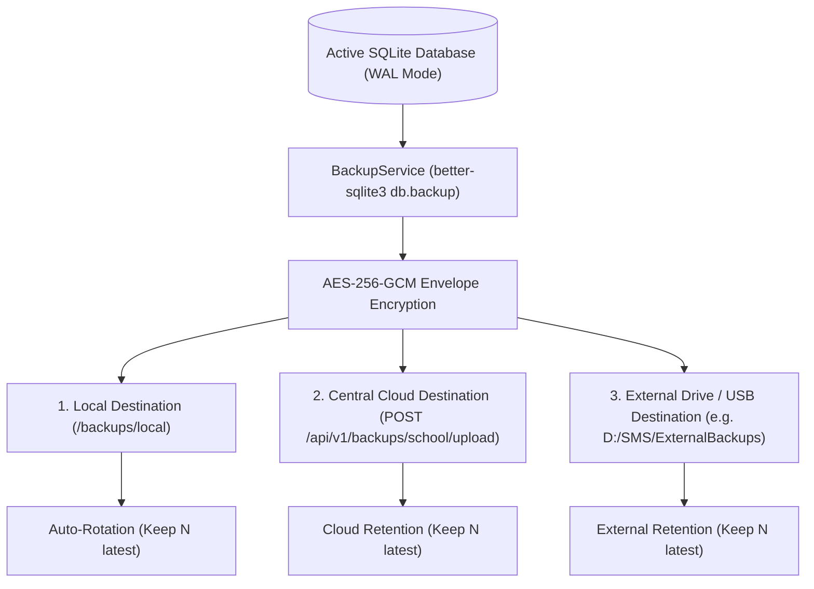
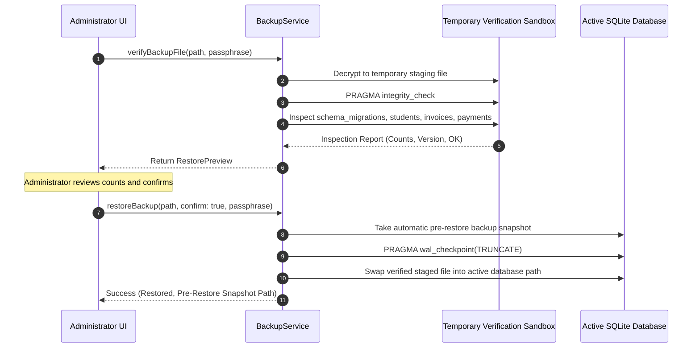

# School Management Software — Comprehensive Backup & Restore Specification

**Document Version:** 1.0.0 (Phase 6 Approved)  
**System Target:** Desktop Application & School OS Cloud Storage Adapter  
**Format:** Versioned Authenticated Envelope (AES-256-GCM + Scrypt)  

---

## 1. Multi-Destination Architecture

To eliminate single points of failure, the backup system provides three independent storage destinations:



### 1.1. Destinations Overview
1. **Local Application Directory:** Instant disaster recovery on the primary machine.
2. **Central Cloud Backend:** Offsite protection against total hardware destruction, ransomware, or device theft.
3. **External Drive / USB:** Physical transportable archive for offline archiving.

---

## 2. WAL-Consistent SQLite Backup Procedure

SQLite in WAL (Write-Ahead Logging) mode writes changes to a separate `-wal` file before checkpointing. Simply copying the `.sqlite` file while transactions are active risks partial or corrupt files.

Phase 6 uses the official SQLite Online Backup API exposed via `better-sqlite3`:
```ts
await this.db.backup(tempRawBackupPath);
```
- Operates concurrently with active readers and writers without taking exclusive table locks.
- Checkpoints active WAL frames into a self-contained, 100% consistent SQLite database.
- Guarantees zero transaction corruption during live operations.

---

## 3. Authenticated Envelope Encryption (AES-256-GCM)

All backups written to disk or sent across the network are encrypted with AES-256 in Galois/Counter Mode (GCM).

### 3.1. Binary Header Structure
```
+----------------+----------------+----------------+----------------+-------------------------+
| Magic (8 B)    | Salt (32 B)    | IV (12 B)      | AuthTag (16 B) | Ciphertext (N Bytes)    |
| 'SMSBAK01'     | Random Salt    | Unique Nonce   | GCM Tag        | Encrypted SQLite File   |
+----------------+----------------+----------------+----------------+-------------------------+
```

### 3.2. Key Derivation & Invariants
- **Key Derivation Function:** `scrypt` (N=16384, r=8, p=1) generating 256-bit cryptographic keys.
- **Passphrase Source:** Derived from school master installation secrets (`installation_id`), or a custom administrator disaster-recovery passphrase.
- **Unique Nonces:** Every backup generates a fresh cryptographically random 12-byte IV and 32-byte salt. Nonces are never reused.
- **Integrity Verification:** The 16-byte authentication tag verifies that the file has not suffered bit rot, truncation, or malicious alteration.

---

## 4. Sandbox Restoration & Safety Guarantee

Restoring a database must never blindly overwrite the production database.



---

## 5. Storage Limitation & Data-at-Rest Disclosure

> [!IMPORTANT]
> **Data-at-Rest Limitation Disclosure:**
> While backup archives are strongly encrypted with AES-256-GCM, the primary SQLite database file in active memory and disk storage is protected via Windows DPAPI filesystem controls rather than full SQLCipher page encryption. Future Phase 7 packaging can integrate SQLCipher once native build binaries are compiled for production release.
