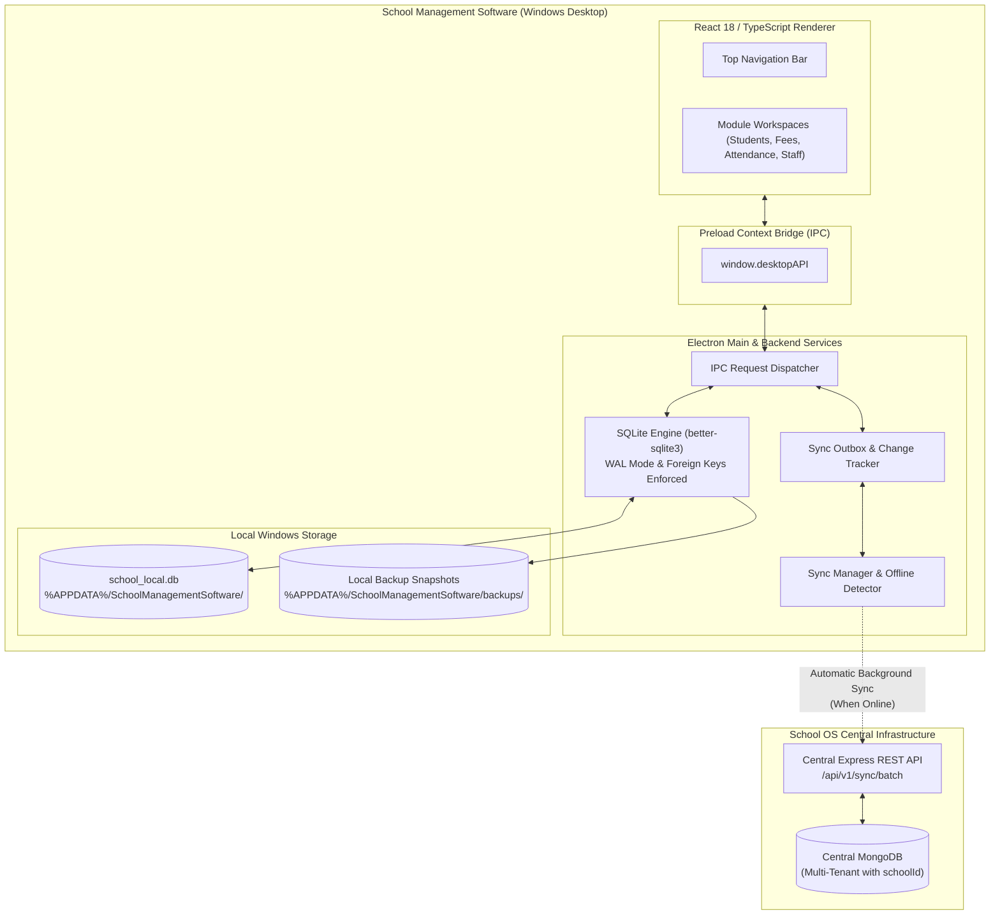
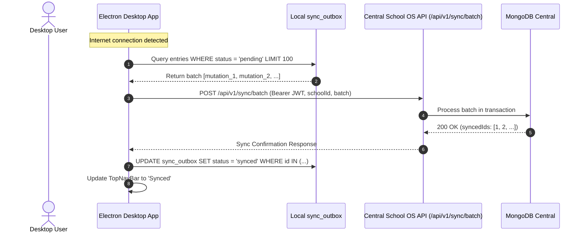

# School Management Software — Local Database & Backend Synchronization Architecture

**Application:** School Management Software (Windows Desktop)  
**Parent Directory:** `D:\SMS\SchoolManagementSoftware`  
**Target Platform:** Windows 10/11 (Single-Machine Offline-First)  
**Target Central Backend:** School OS Backend (`D:\SMS\school-os-backend`)  
**Document Status:** Foundation Blueprint (Phase 1 Approved)

---

## 1. System Overview

School Management Software is built as a single-machine, offline-first Windows desktop application. Unlike web portals that fail when internet connectivity drops, this software operates with zero cloud dependence for daily school functions (admissions, attendance roll call, fee collections, exam marks, and report generation).



---

## 2. Local Database Engine Architecture

### 2.1. Engine Selection: `better-sqlite3`
The desktop application utilizes `better-sqlite3` 13.0 running natively in the Electron main process.

**Technical Rationale:**
- **Synchronous Execution:** Eliminates asynchronous IPC query latency for local database operations. Queries execute in sub-millisecond timeframes.
- **Direct C++ Binding:** Avoids HTTP/WebSocket overhead between the renderer and database.
- **ACID Invariant Compliance:** Guarantees strict transactional rollbacks if any multi-table insertion fails.

### 2.2. Pragma Configurations & Performance Optimization
Upon database connection initialization (`initDatabase()`), the following pragmas are strictly enforced:
```sql
PRAGMA journal_mode = WAL;          -- Enables concurrent reads while writing
PRAGMA foreign_keys = ON;           -- Enforces strict relational integrity
PRAGMA synchronous = NORMAL;        -- Optimal balance between durability and write throughput
```

### 2.3. Storage Paths & File Hierarchy
- **Production Path:** `%APPDATA%\SchoolManagementSoftware\school_local.db`
- **Development Path:** `SchoolManagementSoftware\data\school_local.db`
- **Automated Backup Path:** `%APPDATA%\SchoolManagementSoftware\backups\school_local_backup_<timestamp>.db`

---

## 3. Local Schema Parity with School OS Central Backend

The SQLite relational schema directly mirrors the domain entities established in `school-os-backend`:

| Local SQLite Table | Corresponding School OS Central Model | Domain Scope & Invariant Rules |
| :--- | :--- | :--- |
| `school_profile` | `School` (`src/modules/schools`) | Institution name, registration code, address, Pakistani currency (`Rs.`). |
| `academic_sessions` | `AcademicSession` (`src/modules/academics`) | Session date boundaries (e.g. April 1 to March 31), `is_current` flag. |
| `classes` & `sections` | `SchoolClass` & `Section` | Academic grade hierarchies (Grade 1 through 10) and physical room numbers. |
| `students` | `Student` (`src/modules/students`) | Permanent human student identity: B-Form/CNIC, father name, phone, admission number. |
| `student_enrollments` | `StudentEnrollment` (`src/modules/students`) | Session-specific placement: binds student to `session_id`, `class_id`, and `section_id`. |
| `attendance` | `StudentAttendance` (`src/modules/attendance`) | Daily roll call with `UNIQUE(student_id, date)` preventing duplicate entries. |
| `fee_structures` | `FeeStructure` (`src/modules/fees`) | Grade-wise tuition, admission, and miscellaneous fee schedules. |
| `invoices` | `Invoice` (`src/modules/fees`) | Monthly fee challans with previous dues calculation and balance reconciliation. |
| `payments` | `Payment` (`src/modules/fees`) | Immutable receipt numbers (`RCP-...`), payment date, method (Cash/Bank), collector name. |
| `employees` | `Employee` (`src/modules/employees`) | Staff profiles, qualification, teacher assignments, and duty status. |
| `sync_outbox` | N/A (Client-side sync engine) | FIFO mutation journal capturing offline transactions for cloud sync. |

---

## 4. Offline Change Tracking: Outbox Pattern

To achieve reliable synchronization without data loss, every write operation performed offline is recorded inside the local `sync_outbox` table within the same ACID transaction:

```sql
CREATE TABLE IF NOT EXISTS sync_outbox (
  id INTEGER PRIMARY KEY AUTOINCREMENT,
  entity_type TEXT NOT NULL,         -- e.g. 'STUDENT', 'ATTENDANCE', 'PAYMENT'
  entity_id TEXT NOT NULL,           -- Primary key of the affected entity
  operation TEXT NOT NULL,           -- 'INSERT', 'UPDATE', 'DELETE'
  payload_json TEXT NOT NULL,        -- Complete JSON snapshot of the mutation
  status TEXT DEFAULT 'pending',     -- 'pending', 'syncing', 'synced', 'failed'
  retry_count INTEGER DEFAULT 0,
  error_message TEXT,
  created_at TEXT DEFAULT (datetime('now')),
  synced_at TEXT
);
```

### Lifecycle of an Offline Mutation:
1. **User Action:** School clerk enters a fee payment while internet is down.
2. **Atomic Write:** The payment record is inserted into `payments`, `invoices.balance` is decremented, and an outbox entry is appended to `sync_outbox` with `status = 'pending'`.
3. **UI Feedback:** The top navigation bar instantly displays `Offline Mode` and updates the pending sync badge: `Sync (1)`.
4. **Resilience:** The application can be restarted or shut down; zero data is lost.

---

## 5. Synchronization Protocol with Central Backend

When internet connectivity is restored:



### 5.1. Conflict Resolution Policies
1. **Financial Ledgers & Payments (Immutable Additive Strategy):**
   - Receipts and payment allocations are strictly additive and immutable.
   - The central backend reconciles invoice balances upon payment receipt; neither client nor server overwrites receipt records.
2. **Student Attendance (Idempotent Roll-Call):**
   - Scoped strictly by `student_id` and calendar `date`.
   - If an attendance record for that date already exists on the server, the latest timestamp takes precedence.
3. **Student Profile Data (Last-Write-Wins with Version Vectors):**
   - Each student profile carries a `sync_version INTEGER`.
   - The higher version vector wins, ensuring administrative corrections take effect.

---

## 6. Security & Credentials Isolation

In accordance with strict project safety requirements:
- **No Hardcoded Production Secrets:** The desktop software does not embed central database passwords or production cloud keys.
- **Isolated Token Vault:** When the user connects the desktop to the central backend in Phase 2, the authentication token is stored using the Windows Data Protection API (DPAPI) via Electron's `safeStorage` module.
- **Local Access Isolation:** The renderer process has zero direct filesystem access. All database access is channeled through the strictly audited preload IPC bridge (`window.desktopAPI`).
