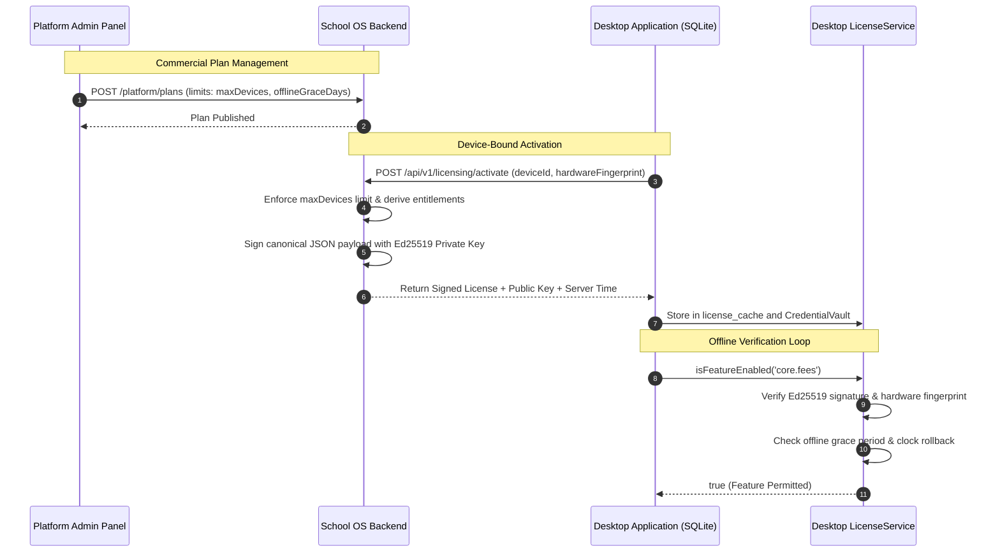

# School Management Software — Subscription & Licensing Specification

**Document Version:** 1.0.0 (Phase 6 Approved)  
**System Target:** School Management Software Desktop Client & School OS Central Backend  
**Security Architecture:** Asymmetric Ed25519 Digital Signatures, Dynamic Entitlement Evaluation, Offline Monotonic Grace Period  

---

## 1. Architectural Overview

The School Management Software licensing architecture enables the platform owner to manage commercial subscriptions, feature bundles, device limits, and offline policies dynamically without code deployments.

Every desktop client validates its commercial rights through an offline-verifiable, digitally signed asymmetric license issued by the central School OS backend.



---

## 2. Dynamic Plan & Feature Management

### 2.1. Central Plan Model
Plans are persisted in the central MongoDB database (`Plan` collection) with publishing workflows:
- **`code`**: Permanent unique plan identifier (e.g., `standard`, `pro_desktop`, `enterprise`).
- **`features`**: Array of feature keys derived from the central feature registry (`src/config/entitlements.ts`).
- **`limits`**:
  - `maxStudents`: Upper bound for active student records.
  - `maxDevices`: Number of desktop workstations allowed to concurrently bind.
  - `offlineGraceDays`: Configurable duration (default 7 days) allowed between online revalidations.
  - `maxCampuses`: Authorized physical campuses.
  - `maxStaffUsers`: Authorized staff accounts.

### 2.2. Feature Entitlements Registry
The system categorizes modules into distinct, configurable capability keys:
- `core.students`: Student management, admissions, enrollment history.
- `core.fees`: Fee invoicing, collections, concessions, challans.
- `core.attendance`: Student roll-call registers and absence alerts.
- `core.academics`: Sessions, classes, sections, subjects.
- `core.examinations`: Date sheets, marks entry, report cards, grading scales.
- `core.staff`: Teacher and employee management.
- `core.payroll`: Salary structures, allowances, deductions, monthly payroll.
- `core.timetable`: Weekly schedule and conflict detection engine.
- `core.reports`: Comprehensive institutional analytics and CSV exports.
- `core.cloud_sync`: Bidirectional SQLite-to-Cloud synchronization.
- `core.cloud_backup`: Automated encrypted cloud backups.

### 2.3. Entitlement State Evaluation
For every capability request, the engine evaluates:
1. **Feature In Plan & Enabled:** Full read and write operations permitted.
2. **Feature Not In Plan:** Access denied with `FEATURE_NOT_IN_PLAN`.
3. **Expired or Grace Expired:** Enters **Restricted Read-Only Access Mode**. Historical data remains readable; backup and export remain active; write mutations are rejected with `LICENSE_RESTRICTED`.

---

## 3. Cryptographic License Verification

### 3.1. Algorithm & Key Management
- **Cryptographic Standard:** Ed25519 (RFC 8032) Edwards-curve Digital Signature Algorithm.
- **Key Separation:**
  - **Private Signing Key:** Kept exclusively on central backend servers (environment variable or HSM). Never transmitted or embedded in desktop distributions.
  - **Public Verification Key:** Distributed to desktop clients via `/licensing/public-key` and cached locally.
- **Payload Normalization:** Canonical JSON with sorted object keys to guarantee deterministic signature generation across platforms.

### 3.2. Signed Payload Format
```json
{
  "licenseId": "lic_9e8a7b6c5d4e...",
  "schoolId": "67356789abcdef0123456789",
  "schoolName": "Allied Grammar High School",
  "schoolCode": "AGHS-01",
  "deviceId": "dev_win_ws_01",
  "hardwareFingerprint": "fp_win_a8f9c0e1...",
  "planCode": "pro_desktop",
  "planName": "Professional Desktop",
  "status": "active",
  "issuedAt": "2026-11-14T08:00:00.000Z",
  "expiresAt": "2027-11-14T08:00:00.000Z",
  "gracePeriodDays": 7,
  "entitlements": ["core.students", "core.fees", "core.attendance", "..."],
  "limits": {
    "maxStudents": 1000,
    "maxDevices": 3,
    "maxStaffUsers": 50
  },
  "licenseVersion": 1
}
```

---

## 4. Key Rotation & Security Governance

1. **Versioned Signatures:** Every license payload includes `licenseVersion: 1`. Future algorithm upgrades (e.g. quantum-resistant algorithms) increment the version indicator.
2. **Public Key Rotation:** Desktop clients request the latest public verification key from `GET /api/v1/licensing/public-key` upon online handshake.
3. **Emergency Revocation:** If a key or machine is compromised, the platform owner marks the device revoked in the backend. Subsequent online sync or revalidation marks local status as `revoked`.
