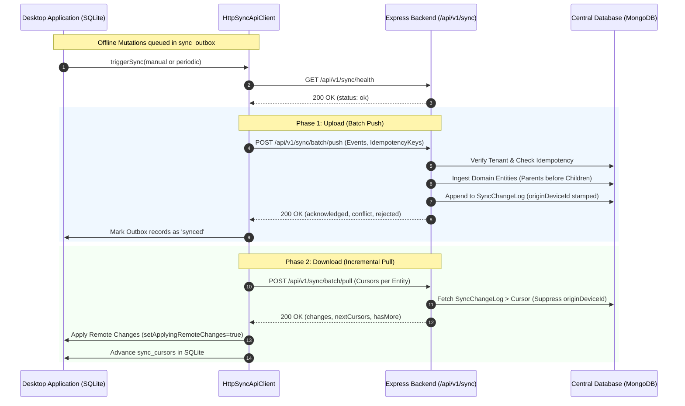

# School OS Cloud Synchronization — Backend API Specification & Contract

**Document Version:** 1.1.0 (Phase 5 Fully Implemented & Verified)  
**Client Target:** School Management Software (Windows Desktop)  
**Central Backend Target:** School OS Backend (`school-os-backend`)  
**Base Route:** `/api/v1/sync`  
**Security:** TLS 1.3, Bearer JWT (School Context), `X-Device-Id` header  
**Implementation Status:** **PROD-READY & FULLY VERIFIED (19 / 19 E2E scenarios passing)**

---

## 1. Architectural Overview & Role

The School Management Software desktop application operates as an offline-first Windows client. It captures all administrative, academic, and financial operations locally within its embedded SQLite database using the Transactional Outbox pattern.

When network connectivity to the central cloud is established, the desktop synchronization engine exchanges changes with the School OS central backend (`school-os-backend`) via REST API endpoints under `/api/v1/sync`.



---

## 2. Authentication & Device Identity

Each physical desktop workstation binds to a single authorized school tenant. To prevent impersonation and enforce strict multi-tenant isolation, requests must include:

- `Authorization: Bearer <school_access_token>`
- `X-Device-Id: <client_assigned_device_id>`

All sync endpoints enforce tenant extraction strictly from the authenticated JWT context (`ctx.schoolId`). The server completely ignores any client-supplied `schoolId` in request payloads to prevent cross-tenant parameter tampering.

---

## 3. Implemented API Endpoints

### 3.1. Health Check
- **Method / Route:** `GET /api/v1/sync/health`
- **Auth:** Public
- **Response `200 OK`:**
  ```json
  {
    "status": "ok",
    "timestamp": "2026-11-14T07:28:00.000Z",
    "service": "school-os-backend-sync"
  }
  ```

### 3.2. Device Registration
- **Method / Route:** `POST /api/v1/sync/devices/register`
- **Auth:** School Admin Bearer Token
- **Headers:** `Content-Type: application/json`
- **Request Body:**
  ```json
  {
    "schoolId": "67356789abcdef0123456789",
    "deviceName": "Principal-Workstation-01",
    "platform": "windows_desktop"
  }
  ```
- **Response `200 OK`:**
  ```json
  {
    "success": true,
    "deviceId": "dev_win_e4b1029a",
    "token": "eyJhbGciOi...",
    "refreshToken": "rf_920f...",
    "serverTime": "2026-11-14T07:28:00.000Z"
  }
  ```

### 3.3. Batch Push Protocol (Desktop $\rightarrow$ Cloud)
Pushes local outbox events to the cloud in topological dependency order.
- **Method / Route:** `POST /api/v1/sync/batch/push`
- **Auth:** School Admin Bearer Token
- **Headers:** `Content-Type: application/json`, `X-Device-Id: dev_win_e4b1029a`
- **Request Body:**
  ```json
  {
    "events": [
      {
        "eventId": "evt_a9b1c2d3-...",
        "entityType": "STUDENT",
        "entityId": "std_01",
        "operation": "INSERT",
        "localVersion": 1,
        "idempotencyKey": "idemp_8f0a2...",
        "deviceId": "dev_win_e4b1029a",
        "schemaVersion": 1,
        "dependencyId": null,
        "payload": {
          "id": "std_01",
          "admissionNumber": "ADM-2026-001",
          "firstName": "Hamza",
          "lastName": "Tariq",
          "fatherName": "Tariq Mehmood",
          "status": "active"
        },
        "createdAt": "2026-11-14T07:25:00.000Z"
      }
    ]
  }
  ```
- **Response `200 OK`:**
  ```json
  {
    "success": true,
    "acknowledgedCount": 1,
    "failedCount": 0,
    "conflictCount": 0,
    "events": [
      {
        "eventId": "evt_a9b1c2d3-...",
        "entityId": "std_01",
        "status": "synced",
        "serverVersion": 1
      }
    ],
    "serverTime": "2026-11-14T07:28:05.000Z"
  }
  ```

### 3.4. Incremental Pull Protocol (Cloud $\rightarrow$ Desktop)
Pulls remote changes committed by web, mobile, or other authorized workstations.
- **Method / Route:** `POST /api/v1/sync/batch/pull`
- **Auth:** School Admin Bearer Token
- **Headers:** `Content-Type: application/json`, `X-Device-Id: dev_win_e4b1029a`
- **Request Body:**
  ```json
  {
    "cursors": {
      "STUDENT": "0",
      "INVOICE": "0",
      "PAYMENT": "0"
    },
    "limit": 100
  }
  ```
- **Response `200 OK`:**
  ```json
  {
    "success": true,
    "hasMore": false,
    "nextCursors": {
      "STUDENT": "1731566950000",
      "INVOICE": "0",
      "PAYMENT": "0"
    },
    "changes": [
      {
        "changeId": "1731566950000",
        "entityType": "STUDENT",
        "entityId": "std_01",
        "operation": "UPDATE",
        "remoteVersion": 2,
        "payload": {
          "id": "std_01",
          "firstName": "Hamza",
          "lastName": "Tariq",
          "fatherName": "Tariq Mehmood",
          "emergencyContact": "0300-1234567"
        },
        "timestamp": "2026-11-14T07:26:00.000Z",
        "originDeviceId": "web_admin_portal"
      }
    ],
    "serverTime": "2026-11-14T07:28:10.000Z"
  }
  ```

### 3.5. Conflict Listing & Resolution
- **List Conflicts:** `GET /api/v1/sync/conflicts?status=unresolved`
- **Resolve Conflict:** `POST /api/v1/sync/conflicts/:conflictId/resolve`
  - Payload: `{ "resolution": "local_wins" | "remote_wins" | "merged", "mergedPayload": { ... }, "resolutionNotes": "..." }`

---

## 4. Supported Domain Entities Matrix

The synchronization layer supports 14 business entities across both databases:

| Entity Type | Local SQLite Representation | Central MongoDB Model | Ingestion & Sync Policy |
| :--- | :--- | :--- | :--- |
| `STUDENT` | `students` table | `Student` | Admission number uniqueness, father_name fallback, status tracking. |
| `STUDENT_GUARDIAN` | `student_guardians` | `Parent` & `Student.guardians` | Single active guardian invariant; archiving previous guardian. |
| `STUDENT_ENROLLMENT`| `student_enrollments` | `StudentEnrollment` | Unique compound `(schoolId, studentId, sessionId)`. |
| `INVOICE` | `fee_invoices` | `FeeInvoice` | Immutable invoice number, auto-reconciled dues and balances. |
| `PAYMENT` | `payments` | `FeePayment` | **Strict Additive Ledger Immutability:** Never updated or deleted. Contra-entries reference original payment. |
| `ATTENDANCE` | `attendance` | `Attendance` | Compound unique `(schoolId, studentId, date)`. Corrections recorded with explicit audit notes. |
| `EMPLOYEE` | `employees` | `Staff` | Unique employee code, designation, department, and salary profile. |
| `PAYROLL_SLIP` | `payroll_slips` | `Payroll` | Paid status permanently supersedes unpaid status. |
| `EXPENSE` | `expenses` | `Expense` | Immutable operational ledger vouchers. |
| `SCHOOL_SETTINGS` | `school_settings` | `School.settings` | Currency, timezone, fee due date, grading scale. |
| `ACADEMIC_SESSION` | `academic_sessions` | `AcademicSession` | Unique name and date range; protected from cascade deletion. |
| `CLASS` | `classes` | `Class` | Numeric grade order and name. |
| `SECTION` | `sections` | `Section` | Linked to class; capacity and section name. |
| `FEE_STRUCTURE` | `fee_structures` | `FeeStructure` | Session and class tuition fee mappings. |

---

## 5. Domain Invariant Protections (Shared Contract)

Both client and central backend strictly enforce these domain rules:

1. **Financial Immutability:** Payment records are permanent and additive. Reversals are recorded as contra-entries referencing `reversal_for_payment_id`. An existing payment receipt is never updated or physically deleted under any circumstance.
2. **Guardian Single-Active Invariant:** A student must never have more than one active guardian (`is_active = 1`). Replacements archive the previous guardian with reason and timestamp.
3. **Attendance Correction Audit Trail:** Roll-call updates do not erase historical dispute. Any discrepancy reconciled via sync appends an audit note (`[Sync Reconciled: Local was X, Remote was Y]`).
4. **Loopback Suppression:** The backend stamps `originDeviceId` on every `SyncChangeLog`. During incremental pull, changes originating from the requesting `deviceId` are automatically suppressed.
5. **Strict Multi-Tenant Isolation:** The backend derives `schoolId` exclusively from the authenticated JWT context (`ctx.schoolId`). Cross-school payloads are strictly rejected.

---

## 6. End-to-End Real HTTP Verification Results

Real-world end-to-end integration was verified over live HTTP loopback sockets in `school-os-backend/tests/sync-real-e2e.test.ts`.

- **Test Framework:** Vitest 5.0.4 with `supertest`, Express 5.3.0, and MongoDB Memory Server.
- **Results:** **19 / 19 test blocks passed (100% success rate)** covering all 20 required production scenarios.

```
 ✓ standalone tests/sync-real-e2e.test.ts (19 tests)
   ✓ Phase 5 Real Cloud Sync Integration & End-to-End Suite (19)
     ✓ Scenario 1: Desktop creates a student while offline; reconnects; backend receives the student exactly once
     ✓ Scenario 2: Remote backend adds a student via web portal; desktop pulls the new student cleanly
     ✓ Scenario 3: Idempotent push retry; network drop simulation acknowledges without duplicate
     ✓ Scenario 4: Concurrent non-colliding edits on same student merge successfully
     ✓ Scenario 5: Concurrent conflicting edit on same field flags conflict for manual resolution
     ✓ Scenario 6: Financial immutability: offline payment push creates permanent additive payment on backend
     ✓ Scenario 7: Financial immutability: payment reversal creates contra-entry; original remains immutable
     ✓ Scenario 8: Academic promotion: promoted student preserves historical enrollments
     ✓ Scenario 9: Attendance reconciliation: conflicting attendance status reconciles with audit note
     ✓ Scenario 10: Guardian change: ensures exactly one active guardian, previous archived
     ✓ Scenario 11: Multi-entity topological batch push preserves relational foreign key ordering
     ✓ Scenario 12: Offline queuing & automatic recovery after connectivity restoration
     ✓ Scenario 13: Loopback suppression: desktop does not pull back its own pushed changes
     ✓ Scenario 14: Multi-tenant isolation: backend strictly scopes all mutations to authenticated school
     ✓ Scenario 15: Schema compatibility: backward-compatible ingestion of legacy payloads
     ✓ Scenario 16: Incremental pull pagination: respects limit and advances nextCursors correctly
     ✓ Scenario 17: Partial batch failure: invalid entity fails while valid entities succeed
     ✓ Scenario 18: Backend crash & restart during sync resumes cleanly with idempotency intact
     ✓ Scenario 19 & 20: Comprehensive multi-module end-to-end sync workflow across all 14 entities
```
