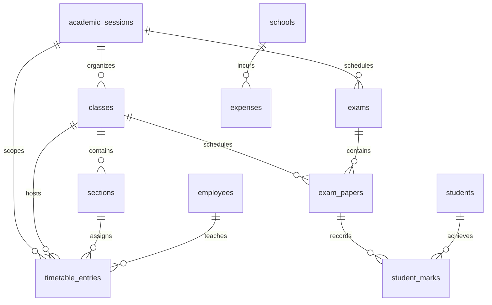

# School Management Software — Phase 3 UI & Module Integration Architecture

## 1. Executive Summary

Phase 3 transitions the School Management Software from a backend-and-authentication foundation into a unified, integrated Windows desktop application. It integrates all 10 planned operational modules with the local SQLite relational database, secure Electron IPC, and a dashboard-driven React renderer.

Rather than providing static prototype mockups or placeholder screens, Phase 3 establishes real database schema extensions (Migration `005`), typed local services, audited repositories, and IPC handlers for all domains. The interface eliminates nested sidebar navigation in favor of a clean, dashboard-led workflow with a top contextual navigation bar.

---

## 2. Desktop Navigation & Visual Architecture

### 2.1 Navigation Principles

1. **Dashboard-Led Hub**:
   - The primary application viewport is the Executive Dashboard.
   - Core operational modules are accessed directly via high-contrast domain cards without complex accordion sidebars.
2. **Contextual Top Navigation Bar (`TopNavBar`)**:
   - Provides institutional identity (`APP_METADATA.APP_NAME`, school branding).
   - Dynamic breadcrumb trail (`Dashboard / <Module Name>`).
   - Modules dropdown switcher for direct cross-module navigation without returning to the home screen.
   - Quick action shortcuts (New Admission, Roll Call, Collect Fee).
   - Live SQLite WAL mode engine diagnostics indicator.
   - Sync Outbox status and offline/online badge.
   - Active user profile tag and cryptographically verified logout.
3. **Ergonomic Viewport Design**:
   - Maximum container width constrained to `max-w-7xl` with automated padding.
   - Guaranteed absence of accidental horizontal scrolling (`overflow-x-hidden` on application root).
   - Dedicated subtle status footer indicating local database durability status and workstation mode.

---

## 3. Shared UI Component Design System

All module pages utilize a standardized design system located in `src/renderer/components/ui/`:

| Component | File | Description & Capabilities |
| :--- | :--- | :--- |
| **`Button`** | [Button.tsx](file:///D:/SMS/SchoolManagementSoftware/src/renderer/components/ui/Button.tsx) | Primary, Secondary, Outline, Danger, Ghost, and Success variants; `isLoading` spinner state; icon adornments; keyboard focus rings. |
| **`Input`** | [Input.tsx](file:///D:/SMS/SchoolManagementSoftware/src/renderer/components/ui/Input.tsx) | Text, number, password, and date inputs with integrated label, helper text, validation error text, and left icon adornments. |
| **`Select`** | [Select.tsx](file:///D:/SMS/SchoolManagementSoftware/src/renderer/components/ui/Select.tsx) | Accessible dropdown select with custom chevron, label, error state, and options array. |
| **`Badge`** | [Badge.tsx](file:///D:/SMS/SchoolManagementSoftware/src/renderer/components/ui/Badge.tsx) | Status indicators (Primary, Success, Warning, Danger, Default); optional pulsating indicator dot. |
| **`Modal`** | [Modal.tsx](file:///D:/SMS/SchoolManagementSoftware/src/renderer/components/ui/Modal.tsx) | Accessible dialog with dark backdrop blur, header, footer action slots, Escape key listener, and click-outside dismissal. |
| **`Card`** | [Card.tsx](file:///D:/SMS/SchoolManagementSoftware/src/renderer/components/ui/Card.tsx) | Modular cards with `CardHeader`, `CardTitle`, `CardDescription`, `CardContent`, and `CardFooter`. |
| **`Tabs`** | [Tabs.tsx](file:///D:/SMS/SchoolManagementSoftware/src/renderer/components/ui/Tabs.tsx) | Horizontal tab controller supporting pills and underline variants, badges, and icon indicators. |
| **`DataTable`** | [DataTable.tsx](file:///D:/SMS/SchoolManagementSoftware/src/renderer/components/ui/DataTable.tsx) | Generic table component with column configuration, search bar, row click listener, loading state, and empty state rendering. |
| **`ConfirmDialog`** | [ConfirmDialog.tsx](file:///D:/SMS/SchoolManagementSoftware/src/renderer/components/ui/ConfirmDialog.tsx) | High-contrast confirmation modal for destructive operations (e.g., student archival, invoice voiding). |
| **`EmptyState`** | [EmptyState.tsx](file:///D:/SMS/SchoolManagementSoftware/src/renderer/components/ui/EmptyState.tsx) | Zero-record state with icon, explanatory message, and contextual primary call-to-action. |

---

## 4. Full 10-Module Feature Integration Matrix

All 10 modules are integrated with real local SQLite persistence, validation schemas, and IPC channels:

| # | Module Name | Renderer View | Local SQLite Tables | IPC Handlers | Capabilities & Workflows |
| :--- | :--- | :--- | :--- | :--- | :--- |
| **1** | **Students & Admissions** | [StudentsView.tsx](file:///D:/SMS/SchoolManagementSoftware/src/renderer/views/StudentsView.tsx) | `students`, `student_enrollments`, `classes`, `sections` | `students:get-list` `students:admit` `students:archive` `students:promote` | Searchable directory; Grade filter; New Admission modal with B-Form/CNIC & roll number; Student profile drawer; Safe archival with historical preservation; Session promotion. |
| **2** | **Daily Attendance** | [AttendanceView.tsx](file:///D:/SMS/SchoolManagementSoftware/src/renderer/views/AttendanceView.tsx) | `attendance`, `students`, `classes`, `sections` | `attendance:get-summary` `attendance:record` | Date picker; Grade selector; Interactive roll call (Present, Absent, Late); One-click "Mark All Present"; Batch database save with unique composite constraint. |
| **3** | **Fees & Invoicing** | [FeesView.tsx](file:///D:/SMS/SchoolManagementSoftware/src/renderer/views/FeesView.tsx) | `invoices`, `payments`, `students` | `fees:get-summary` `fees:get-invoices` `fees:create-invoice` `fees:cancel-invoice` `fees:collect` `fees:reverse` | Financial overview cards (Billed, Collected, Outstanding); Generate Challan modal; Collect Payment modal with payment methods; Soft invoice cancellation; Strict immutable contra-entry reversal. |
| **4** | **Sessions & Classes** | [AcademicsView.tsx](file:///D:/SMS/SchoolManagementSoftware/src/renderer/views/AcademicsView.tsx) | `classes`, `sections`, `academic_sessions` | `classes:get-list` `classes:create` `sessions:get-list` `sessions:create` | Dual tab layout (Classes / Sessions); Class card grid showing section pills and enrolled student counts; Add Class Grade modal with automatic section parsing; Add Academic Session modal. |
| **5** | **Examinations & Marks** | [ExamsView.tsx](file:///D:/SMS/SchoolManagementSoftware/src/renderer/views/ExamsView.tsx) | `exams`, `exam_papers`, `student_marks` | `exams:get-list` `exams:create` `exams:get-papers` `exams:create-paper` `exams:get-marks` `exams:record-marks` | Master-detail layout; Exam term list; Paper schedule table; Schedule Exam modal; Add Subject Paper modal; Full Marks Entry modal with absent toggles and local persistence. |
| **6** | **Faculty & Staff** | [StaffView.tsx](file:///D:/SMS/SchoolManagementSoftware/src/renderer/views/StaffView.tsx) | `employees` | `staff:get-list` `staff:create` | Staff card directory; Search by name, code, designation; Designation/Status filter; Add Staff Member modal with qualifications, contact info, and joining date. |
| **7** | **Timetable & Scheduling** | [TimetableView.tsx](file:///D:/SMS/SchoolManagementSoftware/src/renderer/views/TimetableView.tsx) | `timetable_entries`, `classes`, `sections`, `employees` | `timetable:get-list` `timetable:create` `timetable:delete` | Grade and section selector; Monday–Saturday day tabs; Weekly period slot schedule table; Assign Period modal with teacher and facility allocation; Immediate period slot deletion. |
| **8** | **Accounts & Expenses** | [AccountsView.tsx](file:///D:/SMS/SchoolManagementSoftware/src/renderer/views/AccountsView.tsx) | `expenses`, `invoices`, `payments` | `expenses:get-list` `expenses:get-summary` `expenses:create` | Cash flow metrics (Fee Income, Expenditures, Net Operating Balance); Category breakdown; Record Expense Voucher modal with payee and voucher reference; Expenses ledger table. |
| **9** | **Reports & Export** | [ReportsView.tsx](file:///D:/SMS/SchoolManagementSoftware/src/renderer/views/ReportsView.tsx) | Cross-domain relational queries | `reports:generate` | Four core institutional report templates (Student Roster, Fee Defaulters, Attendance Summary, Staff Directory); Live preview table; One-click CSV export via Blob download; Clean print output. |
| **10** | **System & Sync Manager** | [SettingsView.tsx](file:///D:/SMS/SchoolManagementSoftware/src/renderer/views/SettingsView.tsx) | `installation_config`, `sync_outbox`, `audit_logs` | `db:get-status` `db:integrity-check` `db:backup` `sync:get-status` `sync:trigger` `auth:change-password` | SQLite engine diagnostics (WAL mode, page size, database path); Manual backup snapshot trigger; Sync outbox queue inspector; Admin password change vault; Hardware/Electron specifications. |

---

## 5. Database Schema Extensions (Migration 005)

To guarantee that all 10 modules possess legitimate relational storage, forward migration `005_academic_and_financial_extensions.ts` was deployed.

### 5.1 Tables Created

1. **`exams`**:
   - `id VARCHAR(50) PRIMARY KEY`
   - `school_id VARCHAR(50) NOT NULL REFERENCES schools(id) ON DELETE RESTRICT`
   - `session_id VARCHAR(50) NOT NULL REFERENCES academic_sessions(id) ON DELETE RESTRICT`
   - `name VARCHAR(100) NOT NULL`
   - `term VARCHAR(30) NOT NULL` (`first_term`, `mid_term`, `final_term`, `monthly_test`, `other`)
   - `start_date DATE NOT NULL`, `end_date DATE NOT NULL`
   - `status VARCHAR(20) DEFAULT 'draft'`
2. **`exam_papers`**:
   - `id VARCHAR(50) PRIMARY KEY`
   - `school_id VARCHAR(50) NOT NULL REFERENCES schools(id) ON DELETE RESTRICT`
   - `exam_id VARCHAR(50) NOT NULL REFERENCES exams(id) ON DELETE RESTRICT`
   - `class_id VARCHAR(50) NOT NULL REFERENCES classes(id) ON DELETE RESTRICT`
   - `subject_name VARCHAR(100) NOT NULL`
   - `max_marks REAL NOT NULL`, `pass_marks REAL NOT NULL`
   - `exam_date DATE`, `start_time VARCHAR(20)`, `duration_minutes INTEGER`
3. **`student_marks`**:
   - `id VARCHAR(50) PRIMARY KEY`
   - `school_id VARCHAR(50) NOT NULL REFERENCES schools(id) ON DELETE RESTRICT`
   - `exam_id VARCHAR(50) NOT NULL REFERENCES exams(id) ON DELETE RESTRICT`
   - `paper_id VARCHAR(50) NOT NULL REFERENCES exam_papers(id) ON DELETE RESTRICT`
   - `student_id VARCHAR(50) NOT NULL REFERENCES students(id) ON DELETE RESTRICT`
   - `obtained_marks REAL`, `is_absent INTEGER DEFAULT 0`, `remarks TEXT`
   - Unique Index: `(school_id, paper_id, student_id)`
4. **`timetable_entries`**:
   - `id VARCHAR(50) PRIMARY KEY`
   - `school_id VARCHAR(50) NOT NULL REFERENCES schools(id) ON DELETE RESTRICT`
   - `session_id VARCHAR(50) NOT NULL REFERENCES academic_sessions(id) ON DELETE RESTRICT`
   - `class_id VARCHAR(50) NOT NULL REFERENCES classes(id) ON DELETE RESTRICT`
   - `section_id VARCHAR(50) NOT NULL REFERENCES sections(id) ON DELETE RESTRICT`
   - `day_of_week INTEGER NOT NULL` (1=Mon ... 7=Sun)
   - `period_name VARCHAR(50) NOT NULL`, `start_time VARCHAR(20) NOT NULL`, `end_time VARCHAR(20) NOT NULL`
   - `subject_name VARCHAR(100) NOT NULL`
   - `teacher_id VARCHAR(50) REFERENCES employees(id) ON DELETE RESTRICT`
   - `room_number VARCHAR(50)`
5. **`expenses`**:
   - `id VARCHAR(50) PRIMARY KEY`
   - `school_id VARCHAR(50) NOT NULL REFERENCES schools(id) ON DELETE RESTRICT`
   - `category VARCHAR(50) NOT NULL` (`utilities`, `salaries`, `stationery`, `procurement`, `maintenance`, `rent`, `events`, `other`)
   - `amount REAL NOT NULL CHECK(amount > 0)`
   - `expense_date DATE NOT NULL`
   - `vendor VARCHAR(100)`, `description TEXT NOT NULL`
   - `payment_method VARCHAR(30) DEFAULT 'cash'`, `reference VARCHAR(100)`
   - `created_by VARCHAR(50) NOT NULL`

---

## 6. Security, Session Invalidation & Financial Invariants

1. **Strict Financial Immutability Preserved**:
   - The original payment row in `payments` is never modified in-place.
   - Payment reversal creates an independent negative contra-entry referencing `reversal_for_payment_id`.
   - Invoice deletion is permanently restricted whenever payment records exist.
2. **Session Invalidation & RBAC Verification**:
   - Every single IPC handler enforcing domain logic invokes `requireSession(token)`.
   - Expired or revoked session tokens immediately reject requests with clear cryptographic validation errors.
   - Granular RBAC permissions (`students:manage`, `academics:manage`, `fees:manage`, `reports:read`, etc.) prevent role escalation.
3. **School Data Isolation**:
   - All database tables and SQL queries enforce tenant isolation via `school_id = ?`.
   - Multi-tenant boundary crossing is blocked by `InstallationService.assertSchoolIsolation()`.

---

## 7. Verification & Launch Confidence

- **TypeScript Main Process**: 0 errors (`tsc -p tsconfig.main.json`).
- **React 18 / Vite 6 Renderer**: 0 errors (`vite build`, 312 kB bundle size).
- **Automated Tests**: 59 passing tests across 7 test suites (`npm test`).
- **Automated Launch Verification**: Successfully verified headless startup, SQLite WAL initialization, and graceful shutdown with exit code 0 (`npm run verify:launch`).
